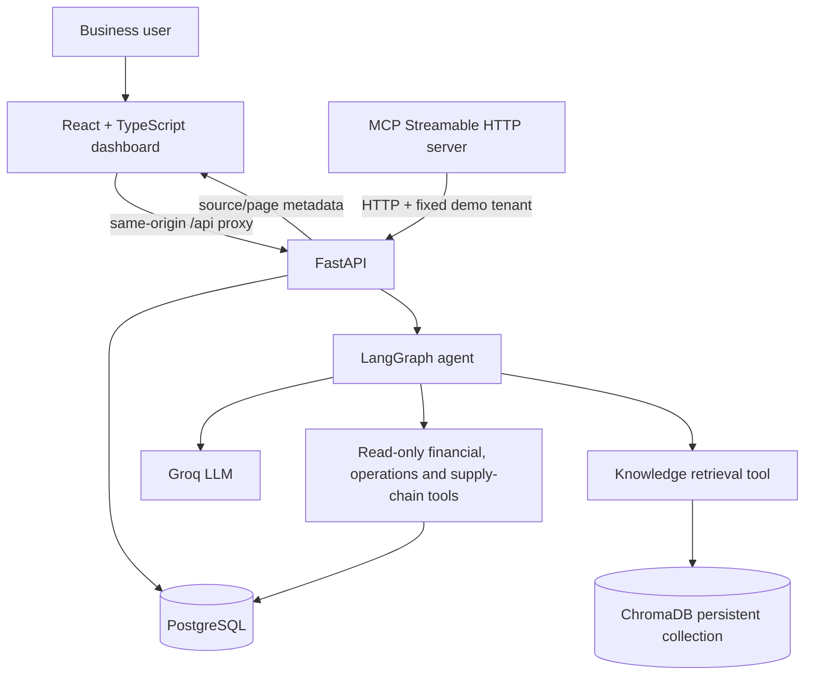

# ProfitPulse AI

**Enterprise-style business intelligence and decision-support prototype for SMEs.**

ProfitPulse AI combines deterministic financial analytics, a LangGraph tool-calling agent, retrieval-augmented generation (RAG), ChromaDB, an MCP server, and a React + TypeScript dashboard. It is designed to demonstrate how a forward-deployed engineer can connect business data and company documents into a usable decision workflow.

> **Demo only:** The included organization and transactions are synthetic. The current `X-Organization-ID` header and fixed frontend/MCP demo tenant are development mechanisms, not production authentication. Do not connect real customer financial data or expose this stack publicly until the blockers in [`docs/deployment-readiness.md`](docs/deployment-readiness.md) are closed.

## What it does

- **Financial intelligence:** period P&L, balance sheet, financial ratios, monthly trends and budget variance.
- **Product and regional analytics:** sales, COGS, gross profit, units and regional performance from delivered order lines.
- **Inventory health:** quantity on hand, inventory valuation and reorder alerts from the latest available snapshot.
- **Supply Chain Intelligence v1:** supplier origin sites, purchase orders, inbound shipments, manually recorded milestones, ETA/delay exceptions, transit-time metrics, supplier scorecards, shipment charges and goods receipts connected to inventory movements.
- **AI business analyst:** Groq-backed LLM with LangGraph tool orchestration over predefined, read-only financial, operational, supply-chain and knowledge tools.
- **Company knowledge base:** PDF, TXT, Markdown and CSV ingestion; page-aware chunking; ChromaDB semantic search; filename/page citations; organization metadata filters; configurable cosine-distance cutoff.
- **MCP server:** Streamable HTTP tools for knowledge search, monthly financial trends and read-only supply-chain visibility.
- **Custom dashboard:** React, TypeScript, Vite, Recharts and Nginx with a same-origin proxy to FastAPI.

## Architecture



See [`docs/architecture.md`](docs/architecture.md) for request flow and component boundaries.

## Tech stack

| Layer | Technology |
|---|---|
| Frontend | React 18, TypeScript, Vite, Recharts, React Markdown, Lucide |
| Web serving | Nginx reverse proxy/static hosting |
| API | Python 3.11, FastAPI, Uvicorn, Pydantic |
| Agent | LangGraph, LangChain Core, LangChain Groq, Groq API |
| Data | PostgreSQL 16, SQL with tenant-scoped transaction context, Python `Decimal` calculations |
| RAG | ChromaDB persistent local vector store, `pypdf`, page-aware chunking |
| Tool interoperability | MCP Python SDK, Streamable HTTP |
| Runtime | Docker Compose |

## Local quick start

### Prerequisites

- Docker Desktop with Docker Compose
- A Groq API key for live AI Analyst requests
- Git (for cloning/version control)

### 1. Configure environment

```bash
cp .env.example .env
```

Edit `.env` before starting:

- Set unique local values for `POSTGRES_ADMIN_PASSWORD` and `APP_DB_PASSWORD`.
- Set `LLM_PROVIDER=groq`.
- Set `GROQ_API_KEY` to your own key. Keep it server-side and never commit `.env`.
- Keep the demo `DEMO_ORGANIZATION_ID` only for local synthetic-data testing.

The current pinned backend requirements include the Groq adapter. Gemini support is not included in this built dependency set; the capabilities metadata is therefore limited to Groq in this release.

### 2. Build and start the stack

```bash
docker compose config --services
docker compose up --build -d
docker compose ps
```

Expected services: `db`, `api`, `mcp`, `frontend`.

### 3. Open the application

- Dashboard: <http://localhost:3000>
- FastAPI OpenAPI UI: <http://localhost:8000/docs>
- API health: <http://localhost:8000/health>
- Database health: <http://localhost:8000/health/db>
- MCP endpoint (local development): <http://localhost:8001/mcp>

The frontend proxies `/api/*` to FastAPI through Nginx. The local app uses the demo organization ID in the frontend code.

### 4. Run backend tests

```bash
docker compose exec api pytest -q
```

The project was verified locally on **6 November 2026** with **53 backend tests passing** (one Starlette/AnyIO deprecation warning). The frontend TypeScript/Vite Docker build and manual dashboard checks also passed in the local environment; see [`docs/qa-report.md`](docs/qa-report.md).

### 5. Useful smoke checks

```bash
curl -i http://localhost:3000/health
curl -i http://localhost:8000/health/db
curl -s http://localhost:8000/api/v1/agent/capabilities | python3 -m json.tool
```

To stop containers without deleting local database/vector data:

```bash
docker compose down
```

> Do not use `docker compose down -v` unless you intentionally want to delete the persistent PostgreSQL and ChromaDB volumes.

## Main API routes

All business and knowledge routes require `X-Organization-ID` in this local demo. The header is a development tenant selector, not an identity credential.

| Area | Method | Route |
|---|---|---|
| Health | GET | `/health`, `/health/db` |
| Agent | GET | `/api/v1/agent/capabilities` |
| Agent | POST | `/api/v1/agent/ask` |
| Organization | GET | `/api/v1/organizations/current` |
| Financials | GET | `/api/v1/financial/summary` |
| Financials | GET | `/api/v1/financial/balance-sheet` |
| Financials | GET | `/api/v1/financial/ratios` |
| Financials | GET | `/api/v1/financial/monthly-trend` |
| Financials | GET | `/api/v1/financial/budget-variance` |
| Operations | GET | `/api/v1/analytics/product-performance` |
| Operations | GET | `/api/v1/analytics/regional-performance` |
| Operations | GET | `/api/v1/analytics/inventory-health` |
| Knowledge | POST | `/api/v1/knowledge/documents` |
| Knowledge | GET | `/api/v1/knowledge/documents` |
| Knowledge | POST | `/api/v1/knowledge/search` |
| Knowledge | DELETE | `/api/v1/knowledge/documents/{document_id}` |
| Imports | POST / GET | `/api/v1/imports/{entity}`, `/api/v1/imports/{job_id}` |

Interactive schemas are available at `/docs` while the local API is running. Additional examples and test procedures are in [`docs/api-reference.md`](docs/api-reference.md).

## Verified demo dataset (August–October 2026)

The seeded organization is a synthetic wholesale/retail business. The values below were returned by the local API during manual QA; they are not actual company performance.

| Financial metric | Verified value |
|---|---:|
| Net revenue | ₹9,06,747.44 |
| COGS | ₹5,61,060.00 |
| Gross profit | ₹3,45,687.44 |
| Gross margin | 38.12% |
| Operating expenses | ₹6,68,000.00 |
| EBITDA | -₹3,22,312.56 |
| Profit after tax | -₹4,26,312.57 |

Operations reconciliation:

- Product performance: 10 SKUs, 452 units sold; product net sales, COGS and gross profit reconcile to the financial P&L for the period. The endpoint uses delivered orders and item line totals (excluding order-level tax/shipping).
- Regional performance: South ₹5,81,897.22; North ₹1,81,337.21; West ₹1,43,513.01. Regional totals reconcile to the same delivered-order line basis.
- Inventory snapshot: 1 November 2026; 10 SKUs, 1,220 units on hand, inventory value ₹13,24,640; no reorder alerts in the seeded snapshot.

See [`docs/qa-report.md`](docs/qa-report.md) for detailed test evidence and important date/basis distinctions.

## Project structure

```text
.
├── backend/
│   ├── src/profitpulse/
│   │   ├── agent/          # LangGraph graph, prompts, LLM and tools
│   │   ├── rag/            # Chroma store and document chunking
│   │   ├── ingestion/      # CSV parsing/import
│   │   ├── routers/        # FastAPI endpoints
│   │   ├── analytics.py    # Product, regional and inventory analytics
│   │   ├── financial.py   # Deterministic financial calculations
│   │   ├── mcp_server.py  # MCP tools/resources/prompts
│   │   └── db.py           # PostgreSQL connection and tenant context
│   ├── tests/              # Backend regression tests
│   ├── Dockerfile
│   └── requirements.txt
├── database/init/          # Schema, roles and synthetic seed data
├── docs/                   # Architecture, QA, security and deployment notes
├── examples/               # Synthetic CSVs and policy document
├── frontend/               # React + TypeScript + Vite + Nginx
└── docker-compose.yml
```

## Design decisions

1. **Deterministic calculations before LLM prose.** Python/SQL produces financial amounts, ratios and period deltas. The model selects tools and explains their results; it is not the accounting engine.
2. **Tool-based, bounded agent.** LangGraph routes between the model and a fixed set of read-only tools. Agent tool rounds are bounded by request validation.
3. **Grounded document answers.** Retrieved passages include document ID, filename and page number. The RAG store filters by organization metadata and suppresses results above a configurable cosine-distance threshold.
4. **MCP as an integration boundary.** The MCP server exposes a small set of tools that call the existing API instead of duplicating business logic.
5. **Same-origin frontend API calls.** Nginx proxies the frontend's `/api` requests to FastAPI in the Compose network.

## Known limitations

- Synthetic demo data only; no real customer adoption, production traffic, revenue uplift or cost savings have been measured.
- No authentication/login. `X-Organization-ID` is caller-supplied and the frontend uses a fixed demo ID.
- MCP is pinned to a fixed demo organization and has no production authentication/origin policy.
- The local ChromaDB store is a single persistent volume. The initial cosine-distance threshold (`0.70`) is only calibrated on a small demo set.
- Scanned PDFs are not OCR'd; only selectable PDF text is indexed. Supported extensions are PDF, TXT, MD and CSV.
- Financial logic is a management-reporting prototype, not audited accounting, tax, legal, investment or IPO advice. Some statement classifications and cash-flow capabilities remain incomplete.
- Inventory is a dated snapshot, not a live stock ledger. The tested snapshot is 1 November 2026.
- Product/region results are based on delivered order line totals and exclude order-level tax/shipping.
- Current local Compose configuration publishes database, API and MCP ports to the host for development. Do not reuse it unchanged for public deployment.

## Portfolio and interview material

- [`docs/portfolio-case-study.md`](docs/portfolio-case-study.md): problem, architecture, implementation, results and honest scope.
- [`docs/demo-script.md`](docs/demo-script.md): a 3–5 minute guided demo.
- [`docs/deployment-readiness.md`](docs/deployment-readiness.md): blockers and production plan.
- [`docs/security-review.md`](docs/security-review.md): trust boundaries and remediation plan.
- [`docs/qa-report.md`](docs/qa-report.md): verified local test outcomes.

## License

No license has been selected in this repository yet. Choose and add a license before inviting reuse or accepting external contributions.

## Supply Chain Intelligence v1

ProfitPulse includes a development Supply Chain workflow for supplier origin sites, purchase orders, inbound shipments, manually recorded milestones, shipment timelines, goods receipts, shipment charges, delay exceptions and supplier scorecards. See [`docs/supply-chain-phase1.md`](docs/supply-chain-phase1.md) and [`docs/supply-chain-api.md`](docs/supply-chain-api.md) for the data model, API routes, metrics and local walkthrough. Apply `database/migrations/20261106_supply_chain_v1.sql` before using the new routes; the optional demo seed is synthetic.

**Current limitations:** carrier/GPS/EDI/customs integrations and supplier email delivery are not connected. Shipment charges are stored separately and are not automatically capitalized into landed cost or posted to the general ledger. `X-Organization-ID` is a local development tenant selector, not production authentication.
