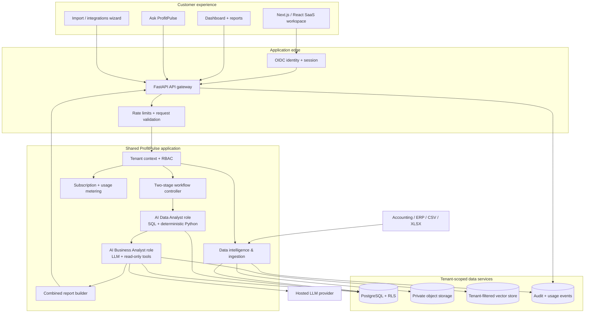

# ProfitPulse AI: Manufacturing SaaS Architecture

Status: showcase architecture and first two-agent workflow implementation
Product decisions: manufacturing SMEs, English reporting, hybrid dashboard + conversational experience.

## Product promise

ProfitPulse is one shared SaaS platform for manufacturing SMEs. A company signs in to one workspace, connects or uploads its business data, sees a live business overview, and can ask questions in natural language. A single intelligence workflow coordinates two specialist roles:

1. **AI Data Analyst**: computes verified financial, sales, product and inventory findings from tenant-scoped records. Deterministic code and SQL own calculations; an LLM does not invent numbers.
2. **AI Business Analyst**: interprets the structured findings, may retrieve additional evidence from existing read-only tools and company documents, and prepares practical, prioritised recommendations.

These are two roles within one workflow, not four independent agent products. The user sees one combined report and one conversational assistant.

## Customer journey

1. Create a company workspace and configure industry, base currency, reporting period and users.
2. Upload supported CSV/XLSX exports or connect accounting/ERP systems.
3. Inspect column mapping, dates, data types, duplicates, missing values and reconciliation warnings.
4. Validate the import and store tenant-scoped source data with import metadata.
5. Open the dashboard for revenue, gross profit, operating expenses, inventory and supplier visibility.
6. Run an investigation. The Data Analyst calculates facts, then the Business Analyst interprets them.
7. Review the combined report, evidence, citations, limitations and recommended actions.
8. Approve actions manually. ProfitPulse is read-only decision support in the initial release.

## Logical architecture

## Shared SaaS tenancy model

Use one application deployment and shared compute for all SMEs, with strict logical data isolation:

- Every business-owned row has a non-null `organization_id`.
- User identity is resolved from a verified OIDC/JWT session.
- A membership table maps a user to one or more organizations and roles.
- The API derives organization context from the authenticated principal. Never trust a browser-provided organization header as authorization.
- PostgreSQL row-level security remains a second isolation boundary; the application database role is not a table owner or superuser.
- Object-storage paths use opaque tenant prefixes and private access policies. Signed URLs are short-lived.
- Vector retrieval always includes mandatory tenant and document access filters.
- Cache keys, background job payloads, exports, logs and audit events are tenant-scoped.
- Cross-tenant access tests are required for every query, upload, report and background job.

Recommended roles: Owner, Admin, Analyst and Viewer. Subscription entitlements are separate from user roles.

## Core domain model

Initial entities:

- `organizations`, `users`, `organization_memberships`
- `subscriptions`, `plans`, `usage_events`
- `data_sources`, `import_jobs`, `import_files`, `column_mappings`
- `customers`, `suppliers`, `products`, `warehouses`
- `orders`, `order_items`, `purchase_orders`, `shipments`
- `inventory_snapshots`, `inventory_movements`
- `gl_accounts`, `journal_entries`, `journal_lines`, `budgets`
- `analysis_runs`, `analysis_findings`, `recommendations`, `recommendation_feedback`
- `documents`, `document_chunks`, `audit_events`

Keep raw uploads immutable for traceability; validated normalized records power analytics. Every import run stores the filename, uploader, checksum, mapping version, row counts, validation errors and timestamps.

## Two-agent contract

### Data Analyst output

A versioned JSON object containing:

- analysis ID and period
- currency and calculation basis
- verified metrics
- findings with severity and explanation
- evidence references/data sources
- freshness and coverage limitations

### Business Analyst input/output

The Business Analyst receives the Data Analyst report plus the user's question and selected company context. It may call only predefined read-only tools. Its output includes:

- business interpretation
- candidate explanations clearly labelled as hypotheses
- prioritised actions
- data required to validate uncertain causes
- sources/citations and limitations

The Business Analyst cannot execute arbitrary SQL, change transactions, send supplier messages, create purchase orders or modify production systems. Any future action capability requires explicit human approval and a separate permissioned service.

## Manufacturing domain roadmap

Showcase release uses the existing deterministic financial, product, inventory and supply-chain capabilities. Do not imply production telemetry exists unless a customer actually connects it.

Next manufacturing datasets/connectors:
- BOM and routings
- work orders and production output
- planned vs actual machine run time and downtime events
- scrap/rework and quality inspection records
- raw material consumption and yield
- purchase order lines, goods receipts and supplier lead times
- finished-goods inventory and dispatch records

Once those sources exist, add deterministic KPIs: schedule attainment, yield, scrap rate, rework rate, machine availability, downtime hours, supplier OTIF, stock cover and production cost variance. Keep formulas and denominators visible.

## Suggested service layout

- Frontend: React/TypeScript now; Next.js is an option when public marketing pages and app routes are needed.
- API: FastAPI modular monolith, with domain routers and a versioned schema.
- Data: PostgreSQL for canonical records and analytics; private S3-compatible storage for uploads.
- Processing: Pandas/Polars for bounded file processing; background queue for larger imports and scheduled refresh.
- Agent workflow: LangGraph controller with deterministic Data Analyst service and one LLM-powered Business Analyst role.
- Retrieval: tenant-filtered vector index for policies/SOPs/contracts, retaining file and page citations.
- Usage: record model, token, processing, storage and request usage per tenant before enforcing plan limits.
- Observability: structured request IDs, tenant-safe audit events, exception monitoring and model quality/cost metrics.

Avoid splitting into microservices until load, team ownership or independent scaling justify it. Begin with a modular monolith and separate workers.

## Subscription model (hypotheses to validate)

Potential starting plans:

| Plan | Indicative price | Initial entitlement direction |
|---|---:|---|
| Starter | ₹1,499 / month | 1 workspace, limited monthly rows, 1 user, monthly refresh |
| Growth | ₹3,999 / month | More rows, 5 users, weekly refresh, full report history |
| Professional | ₹7,999 / month | Higher usage, 15 users, daily refresh, advanced integrations |

These are pricing experiments, not committed commercial offers. Validate willingness to pay and cloud/LLM costs with design partners. Enforce row, file-size, retention, refresh and AI-use quotas to protect gross margin.

## Delivery sequence

1. Showcase vertical slice: manufacturing-oriented dashboard, one combined intelligence workflow, clear sample-data label.
2. Data onboarding: robust CSV/XLSX mapping, validation, preview, import history and sample templates.
3. Security: OIDC authentication, organization membership, verified tenant context, RLS tests and private file access.
4. Manufacturing connectors: start with one ERP/accounting export and one production dataset.
5. Subscription controls: billing checkout, plan entitlements, metering, invoices and cancellation.
6. Reliability: backups/restore drills, rate limits, observability, deletion/export, model fallback and eval suite.
7. Pilot: 3–5 manufacturing SMEs, manually validate recommendations with operations/finance users before automating reports.

## Current showcase limitations

The current GitHub prototype has a synthetic demo organization, a caller-supplied development tenant header and no production login. Its current seed business data is not a complete manufacturing production dataset. Treat this release as a portfolio/design-partner demonstration only; do not ingest confidential customer data or describe it as production-ready. See `docs/deployment-readiness.md` and `docs/security-review.md` for blockers.
